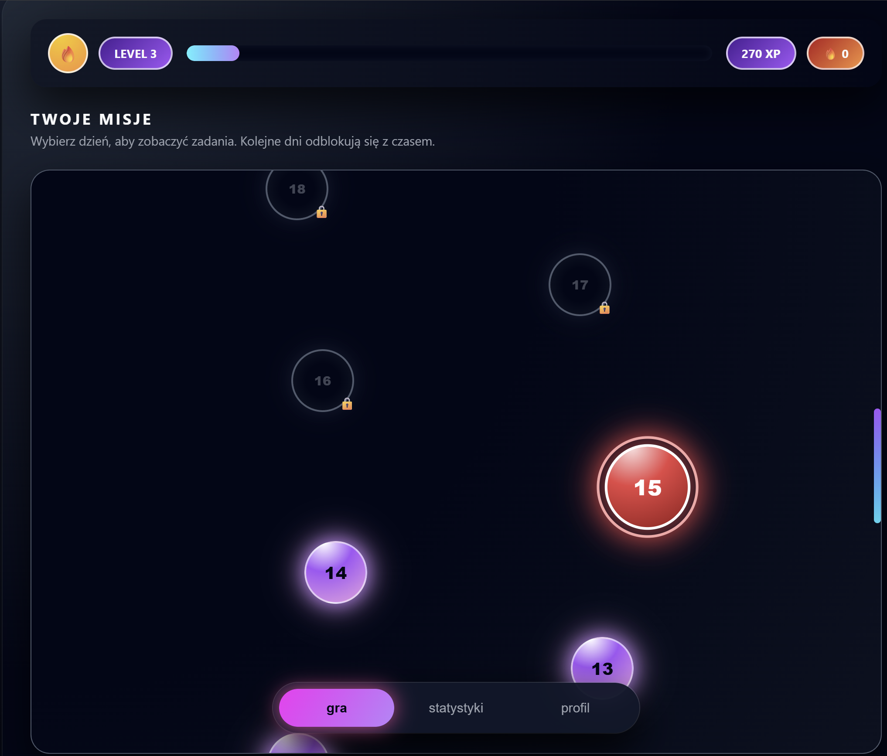
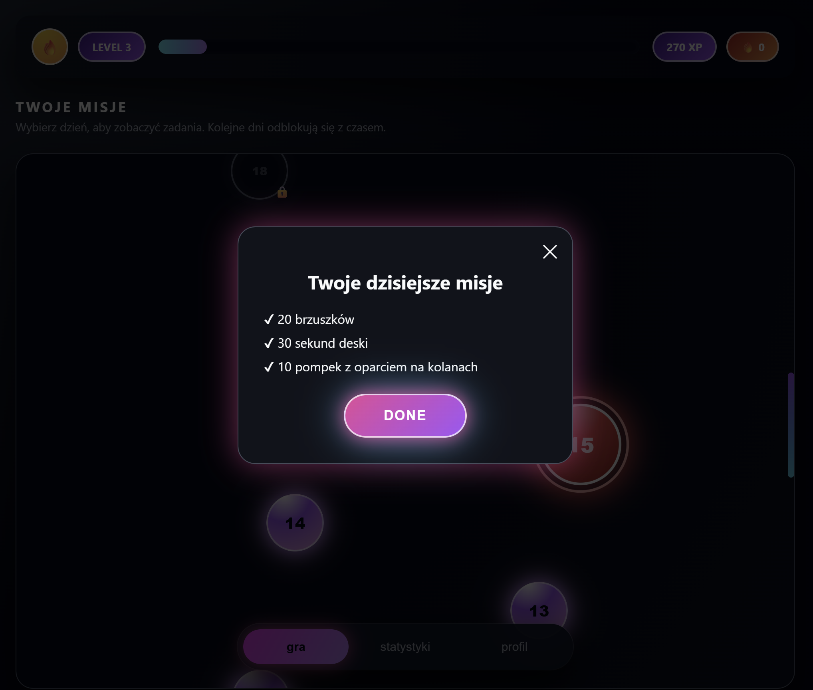
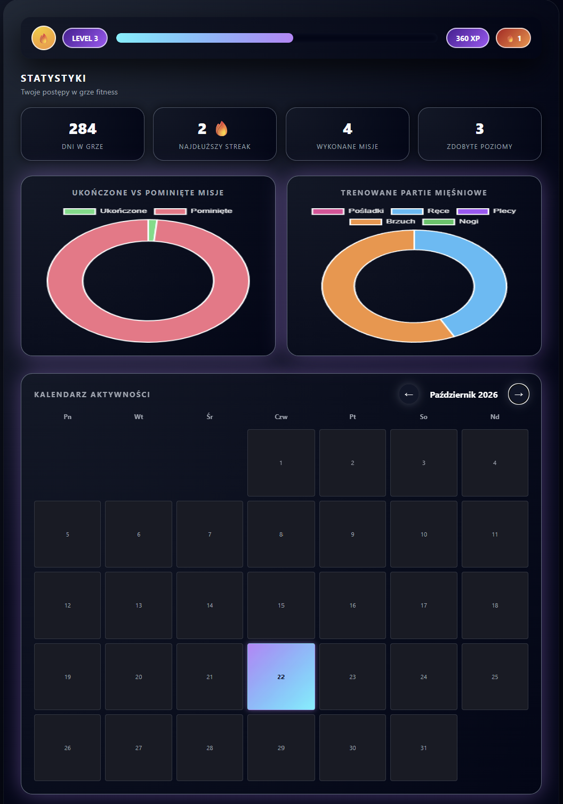
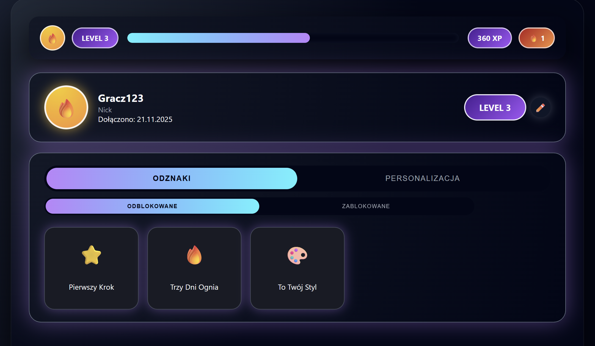
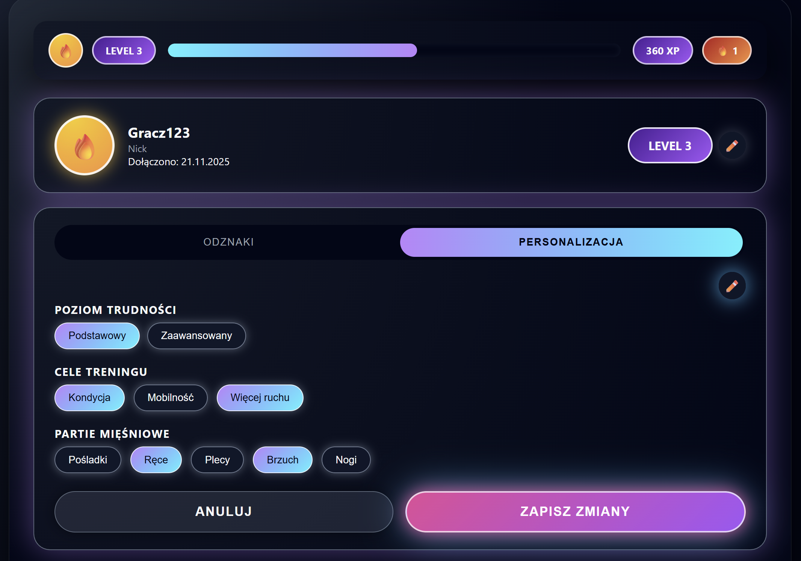

# FitGame - Turn Daily Movement into a Game

FitGame is a browser-based fitness application that makes building an activity habit more engaging through daily missions, experience points, achievements, and visual progress tracking.

Instead of focusing on complex workout metrics, the app encourages users to stay consistent by turning small actions into steps in a game-like journey.

## The Idea

Maintaining a regular exercise routine can be difficult when progress feels distant or difficult to notice. FitGame addresses this challenge with a simple concept: complete a mission, earn a reward, and keep moving forward.

The interface combines a mission map with game progression mechanics and a dashboard that helps users reflect on their activity over time.

## Interface Preview

### Mission Map

The mission map shows the user's current progress, completed stages, and upcoming missions. Special boss missions provide an additional milestone along the way.

### Daily Mission

Missions can be opened to review their details and record completion. Completing a mission provides visual feedback and awards experience points.

### Progress Dashboard

The statistics view presents activity indicators, charts, and a calendar that helps users review completed and skipped missions.

### Profile and Achievements

Users can personalize their profile and track achievements unlocked by reaching activity milestones.

### Mission Personalization

Mission preferences allow users to select difficulty, training goals, and preferred muscle groups.

## Key Features

- **Mission map:** daily stages with current, completed, and locked states, including a special boss mission at every fifth stage.
- **XP and levels:** rewards for completed missions, level progression, and a visual experience bar.
- **Activity streaks:** tracking consecutive days of completed missions.
- **Progress statistics:** activity summaries and charts for completed versus skipped missions and trained muscle groups.
- **Activity calendar:** a calendar view of the user's activity history.
- **Profile customization:** editable nickname and avatar.
- **Achievement system:** badges linked to activity milestones, with separate views for unlocked and locked achievements.
- **Personalized missions:** mission selection based on preferred difficulty, training goals, and muscle groups.
- **Local progress persistence:** saved progress remains available after refreshing the page in the same browser profile.

## Technology Stack

- **HTML** - page structure and application screens.
- **CSS** - visual styling, layout, and smaller-screen adaptations.
- **JavaScript** - interface interactions, mission logic, XP progression, achievements, statistics, and persistence.
- **Chart.js** - charts in the statistics dashboard.
- **LocalStorage** - storing game progress and profile preferences in the browser.

## Run Locally

The project does not require a backend, a package manager, or a build step.

1. Clone or download this repository.
2. Open `index.html` in a modern web browser.
3. Start the application and explore the mission map, profile, and statistics views.

Chart.js is loaded from a CDN, so an internet connection is needed to load the charts.

## Data and Limitations

FitGame is a front-end project. It does not use a server-side account system or synchronize progress between devices.

Game progress and preferences are stored in the browser's LocalStorage. They persist across page refreshes in the same browser profile, but may be lost if the browser's site data is cleared.

## Project Context

FitGame was developed as a team project for the university course **Interfejsy Graficzne** (Graphic Interfaces). The project combines interface design with interactive JavaScript functionality and game-inspired feedback mechanisms.

### Team

- Anna Dębska
- Nikola Garbarz
- Zuzanna Czerwińska
- Alicja Fedor
